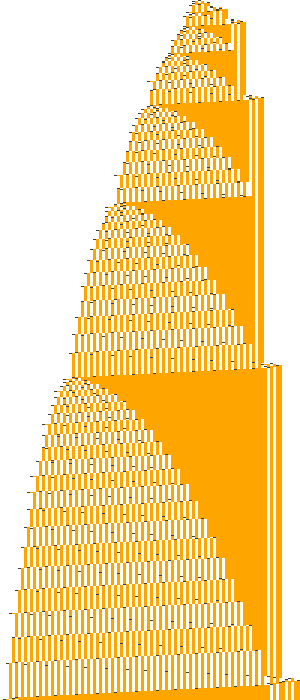
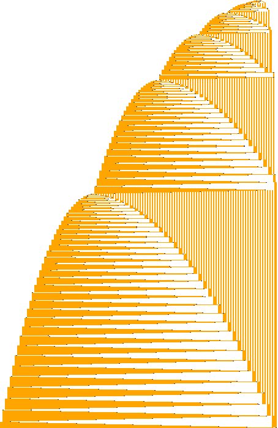
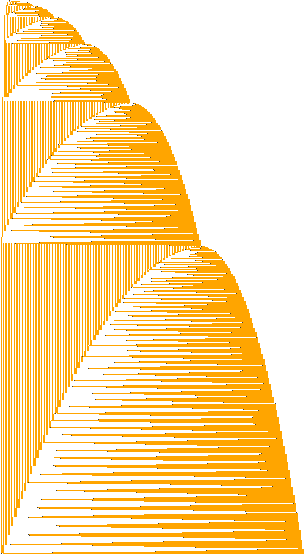
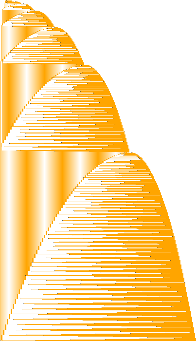
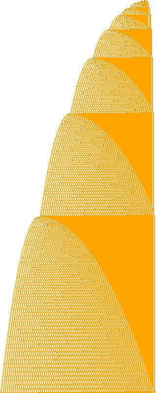
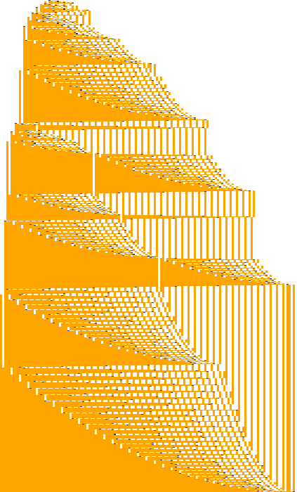

# BB6-vampires

For vampires in BB6 holdouts.

## Overview: Vampire-like TMs in BB6 (23 Nov 2026)

Machines whose Bell map is driven by the digits of one large number n (n' ≈ q·n, with q = 3/2 or 4/3) and a short word or tail, so that a HALT needs a certain sequence of residues of n ("lottery"). The expected values come from a Markov estimate (random residues) and are heuristics, not proofs.

**Status:** *simulated to HALT* = the HALT was found by exact simulation of the Bell map; *+ proof* = in addition a formal Rocq proof; *open* = no HALT found yet.

| no. | machine | type | status | expected HALT (Markov) | computing time to HALT | steps of the original TM |
|---|---|---|---|---|---|---|
| [8](#8) | `1RB0RB_1LC1RF` `0RD0LB_0RA1LE` `1LD---_0RB0RC` | vampire, 4/3, closed table (192 words) | **simulated to HALT + proof** (Bell 298,793,335, 21 Oct; Rocq proof busycoq PR #41, accepted) | 1.6·10⁻⁹ per Bell → ≈ 6·10⁸ Bells | ≈ 2 min on one core (`belldc3`) | ≈ 10^(7.5·10⁷) |
| [1](#1) | `1RB0RF_1LC---` `1RD0LC_0RE0RD` `1LF1LC_1LE1RA` (TM1-F, orbit O2) | vampire family, 3/2, closed table (2,880 words) | **simulated to HALT** (Bell 731,899,010,932, Ahmer Raza, 30 Oct; confirmed by Thomas Reus) | 8.9·10⁻¹³ per Bell → ≈ 1.1·10¹² Bells (median 7.8·10¹¹) | 23 h 42 min on 8 cores (AMD EPYC 9655, `belldco`); ≈ 13–14 days on a notebook | ≈ 10^(2.58·10¹¹) |
| [2](#2) | `1RB---_1LC0RB` `0LD0LC_1RE1RB` `1RD1LF_1LA0LE` (TM1, O1) | as no. 1 | **simulated to HALT** (Bell 747,242,483,684, Ahmer Raza, 30 Oct) | as no. 1 | 24 h 29 min on 8 cores | ≈ 10^(2.63·10¹¹) |
| [3](#3) | `1RB0LA_0RC0RB` `1LD1LA_1LC1RE` `1RF0RD_1LC---` (TM2, O2) | as no. 1 | **simulated to HALT** (orbit O2, as no. 1) | as no. 1 | as no. 1 | ≈ 10^(2.58·10¹¹) |
| [4](#4) | `1RB0RE_1RC---` `0RD0RC_1LE1LF` `1LD1RA_1RC0LF` (TM2', O2) | as no. 1 | **simulated to HALT** (orbit O2, as no. 1) | as no. 1 | as no. 1 | ≈ 10^(2.58·10¹¹) |
| [5](#5) | `1RB0LA_0RC0RB` `1LD1LA_1LC1RE` `1RF0RD_1LA---` (TM2a, O3) | as no. 1 | **simulated to HALT** (Bell 1,961,935,897,288, Ahmer Raza, 30 Oct) | as no. 1 | 79 h on 8 cores (65 h of new progress) | ≈ 10^(6.91·10¹¹) |
| [6](#6) | `1RB---_0RC0RB` `1LD1LE_1LC1RF` `1RB0LE_1RA0RD` (TM2b, O4) | as no. 1 | **simulated to HALT** (Bell 1,941,376,761,248, Ahmer Raza, 1 Nov) | as no. 1 | several days on 8 cores | ≈ 10^(6.84·10¹¹) |
| [7](#7) | `1RB0RF_1LC---` `1LF1LD_1RE0LD` `0RC0RE_1LC1RA` (TM2b', O4) | as no. 1 | **simulated to HALT** (orbit O4, as no. 6) | as no. 1 | as no. 6 | ≈ 10^(6.84·10¹¹) |
| [70](#70) | `1RB1RF_1LC1RD` `1LA1LC_1RA0RE` `1RD1LA_---0LE` | vampire-like, 3/2 (x' = 3x/2 + c), the parity of x/6 drives a rewriting system on a growing stack (table **not** closed, rules learned on the fly); HALT needs an odd stack block to shrink 9 → 7 → 5 → 3 → 1 | **open** (2,334,311,323 Bells, about 10^(8.2·10⁸) steps, no HALT; closest approach: block 5 near the front, 26 times; block 7 10,370 times) | 3·10⁻¹⁴ per Bell (90 %: 2.7–4.5·10⁻¹⁴) → median ≈ 2·10¹³ Bells | out of reach: `sim70dc` runs at 1.5–3.5 million Bells/s on one core, but at the median the stack would need about 44 TB of disk; a first block 3 (about 10¹⁰ Bells) is within reach of a notebook | ≈ 10^(7·10¹²) |
| [86](#86) | `1RB0RE_1RC0RF` `1LD1RA_1LB1LD` `1RA1LB_---0LD` | in lockstep with no. 70 (same left part, only a frozen right end differs); no. 70 is exactly no. 86 started in B | **open** (as no. 70, as long as the lockstep holds) | as no. 70 | as no. 70 | as no. 70 |
| [105](#105) | `1RB1LF_1LC0RD` `---1LA_0LA0RE` `1LA1RA_1LB0LD` | vampire-like, 4/3, small tail counter; 35-level residue path to HALT | **open** (100,000 levels without HALT) | 1.1·10⁻¹⁴ per level → ≈ 9·10¹³ levels (median 6·10¹³) | ≈ 5,000× the TM2 run: about 200 years on a notebook, a few years on a large cluster (simulator still to be written) | ≈ 10^(2.25·10¹³) |
| [51](#51) | `1RB0RE_1LC0RA` `1LA1LD_1LC1LF` `0LC0LB_1LE---` | 8/3 map, memory word r as a stack (table **not** closed); 108-step path to HALT from r = empty | **open** (probviously halting cryptid; 400 macro steps, about 10^320 TM steps, no HALT; closest approach 102 macro steps) | about 3^−80 per reset of r (wiki, Racheline) | out of reach | ≈ 10^10^38 (wiki, heuristic) |
| [61](#61) | `1RB---_0RC0RE` `1RD1RF_1LE0LB` `1RC0LD_1RC1RA` | same machine as no. 51, start state F (in the naming of no. 51); reaches C(12, [6]) after 111 steps | **open** (probviously halting cryptid; 400 macro steps without HALT, closest approach 103 macro steps) | as no. 51 | out of reach | ≈ 10^10^38.1 (wiki, heuristic) |
| [71](#71) | `1RB1RD_1LC0LE` `1RA0LB_1RA1RF` `0RA0RC_1RE---` | same machine as no. 51, start state C; reaches C(16, empty) of no. 51 after 95 steps | **open** (400 macro steps, about 10^320 TM steps, no HALT; closest approach 101 macro steps) | as no. 51 | out of reach | ≈ 10^10^38 (as no. 51) |
| [93](#93) | `1RB0LC_1RC1RE` `1LA0LD_0RB0RA` `1RB1RF_1RD---` | same machine as no. 51, start state B; reaches C(6, empty) of no. 51 after 18 steps | **open** (400 macro steps, about 10^320 TM steps, no HALT; closest approach 103 macro steps) | as no. 51 | out of reach | ≈ 10^10^38 (as no. 51) |
| [31](#31) | `1RB1RF_1RC0LD` `1LB1RA_1RE1LE` `0RC0LB_0RB---` | vampire-like, 4/3, nested sub-process (prefix table mod 6); table with several blocks, not closed | **open** (202 Bells, 10³⁵·⁵ steps without HALT) | below 2·10⁻⁶ per Bell (measured upper bound) | unknown | – |
| [32](#32) | `1RB1LB_0RC0LD` `1LD1RE_1RC0LA` `1RD1RF_0RD---` | as no. 31 (very probably equivalent) | **open** | as no. 31 | unknown | – |

Not included:
- No. 19: it has the scan signature "vampire-like", but a closer look shows a two-number system that is probably non-halting.
- The tetrational cryptids (nos. 60, 62–66) and the needle-like machines (e.g. nos. 42, 45/52): HALT there needs an exact value of a counter, not a residue pattern.

More machines can be added here as they are found.

## Machines

### [8](#t8). `1RB0RB_1LC1RF_0RD0LB_0RA1LE_1LD---_0RB0RC`

### [1](#t1). `1RB0RF_1LC---_1RD0LC_0RE0RD_1LF1LC_1LE1RA`

### [2](#t2). `1RB---_1LC0RB_0LD0LC_1RE1RB_1RD1LF_1LA0LE`

### [3](#t3). `1RB0LA_0RC0RB_1LD1LA_1LC1RE_1RF0RD_1LC---`

### [4](#t4). `1RB0RE_1RC---_0RD0RC_1LE1LF_1LD1RA_1RC0LF`

### [5](#t5). `1RB0LA_0RC0RB_1LD1LA_1LC1RE_1RF0RD_1LA---`

### [6](#t6). `1RB---_0RC0RB_1LD1LE_1LC1RF_1RB0LE_1RA0RD`

### [7](#t7). `1RB0RF_1LC---_1LF1LD_1RE0LD_0RC0RE_1LC1RA`

### [70](#t70). `1RB1RF_1LC1RD_1LA1LC_1RA0RE_1RD1LA_---0LE`

**Equivalence.** No. 70 is exactly no. 86 started in state B: the two machines differ in two transitions, which are only used together in a 3-step detour that ends in the same configuration in both. No. 86 started in A (the real holdout) runs in lockstep with no. 70 after about 3.5·10⁵ steps; only a short frozen part at the right end of the tape differs.

**Bells.** A Bell starts when state A reaches a new leftmost cell with the tape

    1 0^x 1^m 0^g1 1^b1 0^g2 1^b2 ...      (blocks of ones b_i, gaps of zeros g_i)

During a Bell the left block grows by 6 and the gap x shrinks by 4 per sweep, so the next Bell has

    x' = 3x/2 + c

with a small constant c. The list S = [m, g1, b1, g2, b2, ...] is a **stack**: each Bell rewrites only its first few entries (at most 4 pairs), and how it does so depends only on S's front and on x mod 12. In the run x is always divisible by 6, so **one bit per Bell** (x/6 even or odd) drives the stack, as in the vampires (Hydra-like parities). The rules are not a short closed table (more than 60,000 different ones by 2·10⁹ Bells); the simulator learns each rule by direct simulation when it is first needed.

**Way to HALT.** HALT needs a block of length 1 in the stack that is then hit (about 6 % chance). Blocks of length 1 only arise when an odd block shrinks step by step: 9 → 7 → 5 → 3 → 1. Blocks 9 are frequent, every further step is rare. The smallest block seen so far plays the role of the distance D of the vampires.

**Data** (simulation with [`sim70dc`](m70/README.md), exact, 2,334,311,323 Bells, about 10^(8.2·10⁸) TM steps, no HALT):

| quantity | value |
|---|---|
| blocks 9 near the front | 462,215 (2.0·10⁻⁴ per Bell) |
| blocks 7 | 10,370 (4.4·10⁻⁶ per Bell) |
| blocks 5 | 26 (1.1·10⁻⁸ per Bell), first at Bell 48,097,200 |
| blocks 3 / 1 | 0 / 0 |
| P(5 → 3), P(3 → 1) | 0.8 %, 0.6 % (injection tests with [`watch70.py`](m70/README.md): block put into the real stack, 300 Bells with random parities) |
| P(HALT \| block 1) | 6 % |
| first block 3 expected after | about 10¹⁰ Bells |

**Expected HALT (Markov-type estimate).** Rate = (blocks 5 per Bell) · P(5 → 3) · P(3 → 1) · P(HALT | 1) ≈ 1.1·10⁻⁸ · 0.008 · 0.006 · 0.06 ≈ **3·10⁻¹⁴ per Bell** (90 % interval 2.7–4.5·10⁻¹⁴ from the long-run estimator). The rate stays constant over the run, so in this model the machine halts with probability 1:

| | Bells | TM steps |
|---|---|---|
| 50 % (median) | ≈ 2·10¹³ | ≈ 10^(7·10¹²) |
| 99 % | ≈ 1.3·10¹⁴ | ≈ 10^(5·10¹³) |

This is a heuristic, not a proof; the probabilities of the last steps rest on few events and are good to about a factor 3.

**Computing time to HALT.** `sim70dc` runs at 1.5–3.5 million Bells/s on one core, but the stack grows by 2.2 bytes per Bell: at 2·10¹³ Bells it would need about 44 TB of disk (x itself only 1.5 TB). Out of reach with the current program; a first block 3 (about 10¹⁰ Bells, 22 GB) is within reach of a notebook.

### [86](#t86). `1RB0RE_1RC0RF_1LD1RA_1LB1LD_1RA1LB_---0LD`

### [105](#t105). `1RB1LF_1LC0RD_---1LA_0LA0RE_1LA1RA_1LB0LD`

### [51](#t51). `1RB0RE_1LC0RA_1LA1LD_1LC1LF_0LC0LB_1LE---`

### [61](#t61). `1RB---_0RC0RE_1RD1RF_1LE0LB_1RC0LD_1RC1RA`

### [71](#t71). `1RB1RD_1LC0LE_1RA0LB_1RA1RF_0RA0RC_1RE---`

### [93](#t93). `1RB0LC_1RC1RE_1LA0LD_0RB0RA_1RB1RF_1RD---`

### [31](#t31). `1RB1RF_1RC0LD_1LB1RA_1RE1LE_0RC0LB_0RB---`

### [32](#t32). `1RB1LB_0RC0LD_1LD1RE_1RC0LA_1RD1RF_0RD---`

